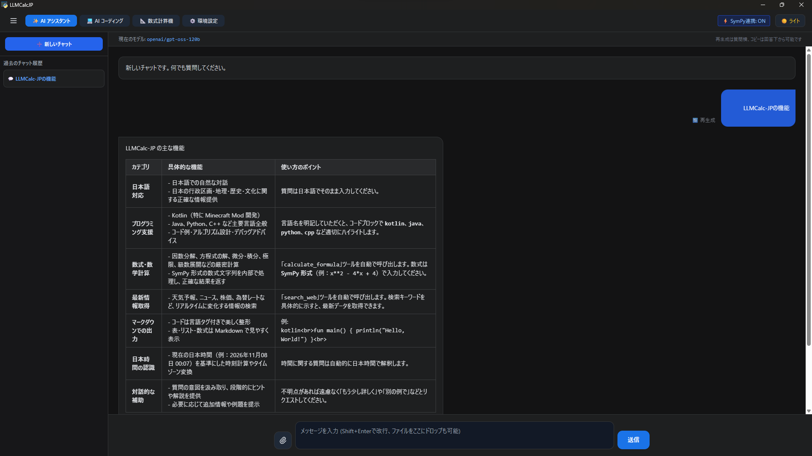
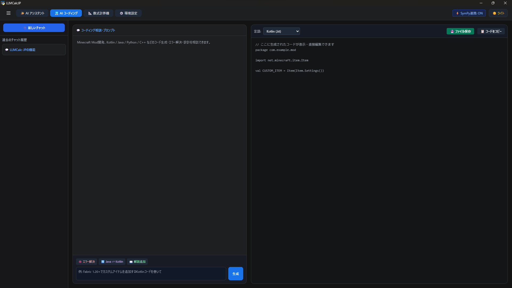
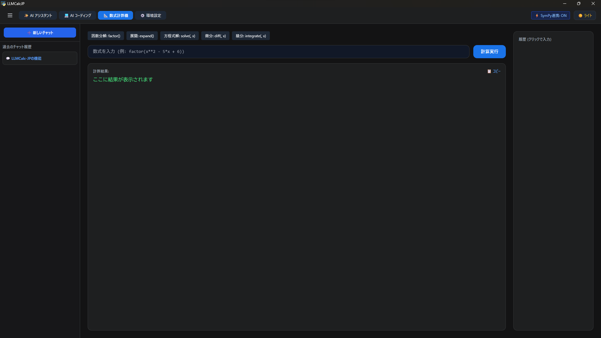
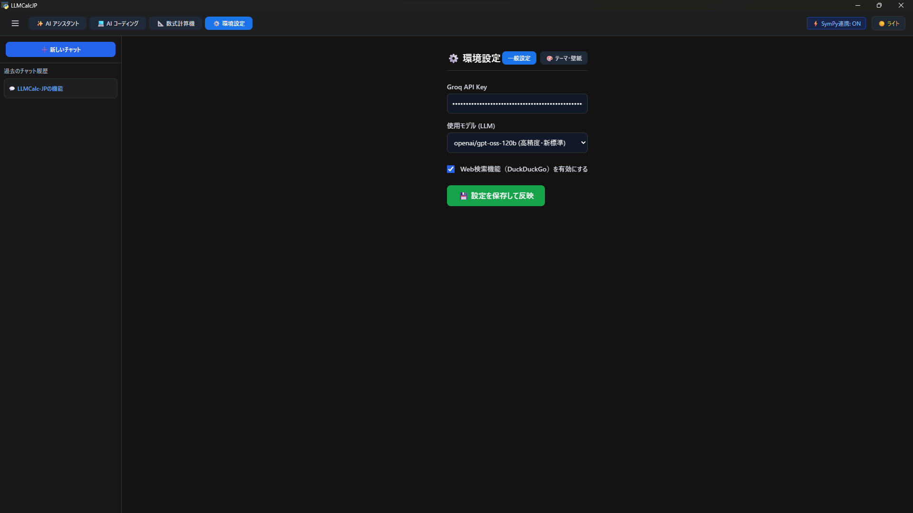
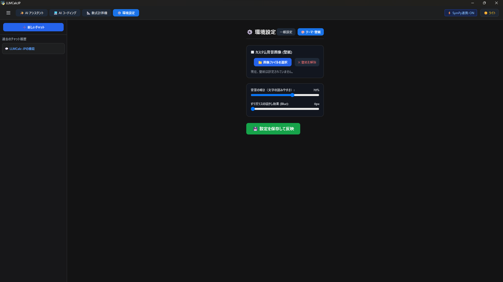

# LLMCalc-JP

<p align="center">
  <strong>AI Assistant × AI Coding × Symbolic Mathematics</strong>
  <br>
  GroqとSymPyを活用した、日本語専用のデスクトップAIアプリケーション。
</p>

<p align="center">
  
  
  
  
  
</p>

**LLMCalc-JP** は、日本国内のユーザーを主な対象として開発された、Python製のデスクトップAIアプリケーションです。

AIアシスタント・AIコーディング・数式計算という3つの機能を統合し、日常的な学習、プログラミング、技術的な作業をサポートします。

Groq APIによる高速なLLM推論と、SymPyによる記号数学処理を組み合わせ、AIの柔軟性と数式処理の正確性を両立することを目指しています。

## 言語について

本プロジェクトは現在、**日本語専用**として開発されています。

- アプリケーションのユーザーインターフェース：日本語
- AIアシスタントの基本応答言語：日本語
- 設定画面・各種メッセージ：日本語
- READMEおよびプロジェクトドキュメント：日本語

現時点では英語を含む他言語への対応は行っておらず、日本語環境での利用を前提としています。

---

## 目次

- [スクリーンショット](#スクリーンショット)
- [主な機能](#主な機能)
  - [AIアシスタント](#1-aiアシスタント)
  - [AIコーディング](#2-aiコーディング)
  - [数式計算機](#3-数式計算機)
  - [Web検索](#4-web検索)
  - [UIカスタマイズ](#5-uiカスタマイズ)
- [技術構成](#技術構成)
- [システムアーキテクチャ](#システムアーキテクチャ)
- [対応AIモデル](#対応aiモデル)
- [動作環境](#動作環境)
- [インストール方法](#インストール方法)
- [初期設定](#初期設定)
- [データ保存](#データ保存)
- [開発背景](#開発背景)
- [ライセンス](#ライセンス)
- [開発者](#開発者)

---

## スクリーンショット

### AIアシスタント

Groq APIを利用したAIチャット機能です。

Markdown、コードブロック、数式などを含む回答をリッチな形式で表示できます。



### AIコーディング

プログラミング支援に特化した2ペイン構成の作業環境です。

左側でAIへの指示・相談を行い、右側で生成されたコードの確認や編集ができます。



### 数式計算機

SymPyを利用した記号数学・数式処理機能です。



### 設定画面

#### 一般設定
API Keyや使用するAIモデルなどを設定できます。



#### テーマ・壁紙設定

アプリのテーマや壁紙を変更できます。
背景画像の暗さやぼかしなども調整でき、好みに合わせて外観をカスタマイズできます。

**変更前**



**変更後**


---

## 主な機能

### 1. AIアシスタント

Groq APIを利用した高速なAIチャット機能です。

**主な機能**

- Groq APIによるLLM推論
- 日本語を基本としたAI応答
- Markdown形式の回答表示
- コードブロックの表示・シンタックスハイライト
- 数式のレンダリング
- 回答の再生成
- 複数の会話セッション管理
- チャット履歴の永続保存
- テキストファイルの添付・読み込み
- Web検索機能との連携

### 2. AIコーディング

プログラミングやソフトウェア開発を支援する専用機能です。

**対応言語・形式**

- Kotlin
- Java
- Python
- C++
- C#
- JavaScript
- JSON
- Gradle Kotlin DSL

**主な機能**

- AIによるコード生成
- 既存コードの解析・解説
- エラー診断・デバッグ支援
- JavaからKotlinへのコード変換
- コードへのコメント・説明の追加
- 生成コードの抽出
- コードエディタ上での直接編集
- コードのコピー・ファイル保存

AIとの対話画面とコードエディタを分離した2ペイン構成により、生成されたコードを確認しながら編集できます。

Minecraft Mod開発をはじめ、さまざまなプログラミング用途での利用を想定しています。

### 3. 数式計算機

**SymPy** を利用した記号数学・数式処理エンジンです。

一般的なLLMによる計算とは異なり、専用の数式処理ライブラリを利用して演算を行います。

**対応する主な演算**

| 演算 | 関数 | 説明 |
|---|---|---|
| 因数分解 | `factor()` | 多項式の因数分解 |
| 展開 | `expand()` | 数式の展開 |
| 方程式 | `solve()` | 方程式の求解 |
| 微分 | `diff()` | 記号微分 |
| 積分 | `integrate()` | 記号積分 |

**入力例**

```python
factor(x**2 - 5*x + 6)

expand((x + 2)**2)

solve(x**2 - 4, x)

diff(x**3 + 2*x, x)

integrate(x**2, x)
```

LLMによる推論とSymPyによる数式処理を分離することで、AIの柔軟な応答と数式処理の厳密性をそれぞれ活用できます。

### 4. Web検索

DuckDuckGoを利用したWeb検索機能です。

外部の情報を取得し、AIアシスタントの回答に活用できます。

Web検索機能は設定から有効・無効を切り替えられます。

### 5. UIカスタマイズ

デスクトップアプリケーションの外観を自由にカスタマイズできます。

**主な設定項目**

- カスタム壁紙の選択
- 背景の暗さの調整
- すりガラス風の半透明パネル
- 背景ぼかし（Blur）の調整
- ダーク・ライトテーマ
- 設定の保存・再適用

標準の壁紙には、長野県白馬村の風景を採用しています。

---

## 技術構成

LLMCalc-JPは、Pythonをバックエンドとし、HTML・CSS・JavaScriptによるWebベースのフロントエンドを統合した構成です。

| 技術 | 用途 |
|---|---|
| Python | アプリケーション本体・バックエンド |
| pywebview | デスクトップウィンドウ・WebView連携 |
| HTML5 | フロントエンド構造 |
| CSS3 | UIデザイン・視覚効果 |
| JavaScript | フロントエンド処理 |
| Tailwind CSS | UIスタイリング |
| Groq API | LLM推論 |
| SymPy | 記号数学・数式処理 |
| DuckDuckGo Search | Web検索 |
| Marked.js | Markdownレンダリング |
| Highlight.js | コードのシンタックスハイライト |
| KaTeX | 数式レンダリング |

### Python

アプリケーションのバックエンドを担当します。

- Groq APIとの通信
- AIへのリクエスト処理
- SymPyによる数式計算
- Web検索処理
- チャット履歴の管理
- アプリケーション設定の管理
- フロントエンドとの連携

### Webフロントエンド

HTML・CSS・JavaScriptを利用してGUIを構築しています。

- AIチャット画面
- 2ペイン式コーディング画面
- 数式計算機画面
- Markdown表示
- コードのシンタックスハイライト
- 数式表示
- 壁紙・テーマのカスタマイズ

### pywebview

PythonとWebフロントエンドを統合し、デスクトップアプリケーションとして動作させるために使用しています。

Pythonの豊富なライブラリエコシステムと、Web技術による柔軟なUI開発を組み合わせています。

---

## システムアーキテクチャ

```text
                  LLMCalc-JP
                       |
           +-----------+-----------+
           |                       |
      Python Backend          Web Frontend
           |                       |
     +-----+------+          +-----+------+
     |            |          |            |
  Groq API      SymPy      HTML/CSS   JavaScript
     |            |          |            |
     +------------+----------+------------+
                       |
                   pywebview
                       |
                 Desktop Window
```

Python側でAI推論・数式処理・データ管理を行い、Webフロントエンド側でユーザーインターフェースを構成します。

---

## 対応AIモデル

LLMの推論にはGroq APIを使用します。

現在の主な対応モデル：

| モデル | 特徴 |
|---|---|
| `openai/gpt-oss-120b` | 高性能な汎用モデル |
| `openai/gpt-oss-20b` | 比較的軽量で高速なモデル |

利用可能なモデルはGroq APIの提供状況およびアプリケーションの設定に依存します。

---

## 動作環境

### 動作確認済み環境

- Windows 11

### 動作確認予定・検証可能な環境

- Linux Mint

Linux Mintについては、開発者が実機を所有しているため、今後動作確認を行う可能性があります。

### 必要な環境

- Python 3
- pywebview対応環境
- インターネット接続
- Groq API Key

本アプリケーションはPythonとpywebviewを利用して開発されています。

必要な依存関係およびWebView環境が整っていれば、その他のOSでも動作する可能性があります。

ただし、Windows 11以外の環境については、現時点で動作を保証していません。

### 動作確認の報告について

Windows 11以外の環境で動作確認を行った場合、OS・バージョン・Pythonのバージョンなどの環境情報とともに、動作状況を報告していただけると助かります。

---

## インストール方法

### 1. リポジトリのクローン

```bash
git clone https://github.com/Suigetsu-Lium/LLMCalc-JP.git
cd LLMCalc-JP
```

### 2. 必要なライブラリのインストール

```bash
pip install pywebview groq sympy duckduckgo-search
```

Web検索機能を利用しない場合、DuckDuckGo Searchは任意です。

※その他の依存関係が必要な場合は、環境に応じて追加してください。

### 3. アプリケーションの起動

```bash
python llmcalc_jp.py
```

---

## 初期設定

### Groq API Keyの設定

AIアシスタントおよびAIコーディング機能を利用するには、Groq API Keyが必要です。

1. LLMCalc-JPを起動します。
2. 「環境設定」を開きます。
3. Groq API Keyを入力します。
4. 使用するAIモデルを選択します。
5. 設定を保存・適用します。

API Keyは以下の公式サイトから取得できます。

[Groq Console](https://console.groq.com/)

### アプリケーション設定

以下の項目をカスタマイズできます。

- 使用するAIモデル
- Web検索機能の有効・無効
- アプリケーションテーマ
- カスタム壁紙
- 背景の暗さ
- 背景ぼかし

---

## データ保存

アプリケーションの設定や会話履歴は、ローカルのJSONファイルで管理されます。

| ファイル | 内容 |
|---|---|
| `chat_history.json` | チャット履歴 |
| `app_config.json` | アプリケーション設定・UI設定 |

---

## 開発背景

LLMCalc-JPは、当初、小規模なPythonデスクトップアプリケーションとして開発を開始しました。

初期段階ではTkinterを使用していましたが、その後、より柔軟で現代的なUIを実現するため、HTML・CSS・JavaScriptを利用したWebViewベースの構成へと発展しました。

本プロジェクトでは、複数の機能をひとつのデスクトップ環境に統合することを目指しています。

- AIによる情報支援
- プログラミング・開発支援
- 正確性を重視した数式処理
- Web情報の取得
- 自由度の高いUIカスタマイズ

特に、すべての処理をLLMに依存させるのではなく、AI推論と数式計算を分離している点が特徴です。

それぞれの技術の得意分野を活用することで、学習・開発・日常的な技術作業を支援する環境を目指しています。

---

## ライセンス

本プロジェクトは **MIT License** のもとで公開されています。

利用・改変・再配布などについては、MIT Licenseの条件に従います。

詳細は [LICENSE](LICENSE) を参照してください。

なお、使用している外部ライブラリやサービスについては、それぞれのライセンスおよび利用規約が適用されます。

---

## 開発者

**Suigetsu-Lium**

- GitHub: [@Suigetsu-Lium](https://github.com/Suigetsu-Lium)
- X: [@Tritium_sub](https://x.com/Tritium_sub)
- Repository: [LLMCalc-JP](https://github.com/Suigetsu-Lium/LLMCalc-JP)

---

<p align="center">
  <strong>LLMCalc-JP</strong>
  <br>
  AI・プログラミング・数式処理を、ひとつの環境へ。
</p>
